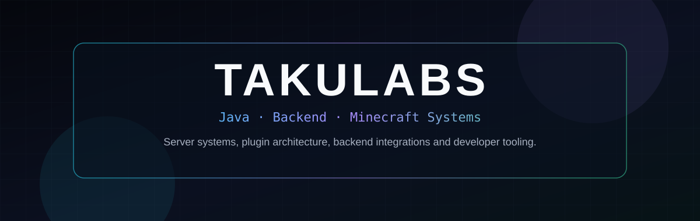

  

  <a href="https://github.com/TakuLabs/minecraft-plugin-portfolio"><b>Portfolio</b></a>
  ·
  <a href="https://github.com/TakuLabs/minecraft-plugin-portfolio/blob/main/docs/plugin-catalog.md"><b>Plugin Catalog</b></a>
  ·
  <a href="https://github.com/TakuLabs/minecraft-plugin-portfolio/blob/main/docs/plugins/empirecrates.md"><b>EmpireCrates</b></a>
  ·
  <a href="https://github.com/TakuLabs/minecraft-plugin-portfolio/tree/main/docs/case-studies"><b>Case Studies</b></a>

  <code>Java 21</code>
  <code>Paper API</code>
  <code>Maven</code>
  <code>ProtocolLib</code>

  

## Development Focus

I build Java-based Minecraft plugins and server systems with Paper, focusing on gameplay, economy, moderation and backend integrations.

My portfolio currently includes 51 Minecraft plugins. Larger projects have detail pages with code examples and technical notes, while private server code and deployment details stay out of the public repo.

## Featured Projects

| Project | Focus |
| --- | --- |
| **[OtakuEmpireCore](https://github.com/TakuLabs/minecraft-plugin-portfolio/blob/main/docs/plugins/otakuempirecore.md)** | Shared core module with economy and GUI systems |
| **[OtakuEmpireCoreSMP](https://github.com/TakuLabs/minecraft-plugin-portfolio/blob/main/docs/plugins/otakuempirecoresmp.md)** | SMP-focused shared core with economy and GUI systems |
| **[CookieClicker](https://github.com/TakuLabs/minecraft-plugin-portfolio/blob/main/docs/plugins/cookieclicker.md)** | Clicker gameplay systems and persistence |
| **[EmpireCrates](https://github.com/TakuLabs/minecraft-plugin-portfolio/blob/main/docs/plugins/empirecrates.md)** | Crate rewards, keys, admin GUI and player progress |
| **[NovaGuard](https://github.com/TakuLabs/minecraft-plugin-portfolio/blob/main/docs/plugins/novaguard.md)** | Connection limits and ProtocolLib-backed packet safeguards |
| **[MythicSpawner](https://github.com/TakuLabs/minecraft-plugin-portfolio/blob/main/docs/plugins/mythicspawner.md)** | Spawner tooling with persistent item and block state |
| **[TakuRTP](https://github.com/TakuLabs/minecraft-plugin-portfolio/blob/main/docs/plugins/takurtp.md)** | Random teleport queue and teleport service |
| **[MythicElevators](https://github.com/TakuLabs/minecraft-plugin-portfolio/blob/main/docs/plugins/mythicelevators.md)** | Elevator blocks, movement and configuration |

  

EmpireCrates in-game showcase

## Plugins

All 51 plugins are linked below. The full catalog adds versions, categories, tests and code excerpts.

### Core / Infrastructure

[EmpireSuite](https://github.com/TakuLabs/minecraft-plugin-portfolio/blob/main/docs/plugins/empiresuite.md) · [EmpireSuiteStandalone](https://github.com/TakuLabs/minecraft-plugin-portfolio/blob/main/docs/plugins/empiresuitestandalone.md) · [MythicEmpireControl](https://github.com/TakuLabs/minecraft-plugin-portfolio/blob/main/docs/plugins/mythicempirecontrol.md) · [NovaContainerOptimizer](https://github.com/TakuLabs/minecraft-plugin-portfolio/blob/main/docs/plugins/novacontaineroptimizer.md) · [OtakuEmpireCore](https://github.com/TakuLabs/minecraft-plugin-portfolio/blob/main/docs/plugins/otakuempirecore.md) · [OtakuEmpireCoreSMP](https://github.com/TakuLabs/minecraft-plugin-portfolio/blob/main/docs/plugins/otakuempirecoresmp.md) · [OtakuSuite](https://github.com/TakuLabs/minecraft-plugin-portfolio/blob/main/docs/plugins/otakusuite.md) · [StaffSuiteStandalone](https://github.com/TakuLabs/minecraft-plugin-portfolio/blob/main/docs/plugins/staffsuitestandalone.md)

### Economy

[EmpireCrates](https://github.com/TakuLabs/minecraft-plugin-portfolio/blob/main/docs/plugins/empirecrates.md) · [EmpireRedeem](https://github.com/TakuLabs/minecraft-plugin-portfolio/blob/main/docs/plugins/empireredeem.md) · [EmpireSellStandalone](https://github.com/TakuLabs/minecraft-plugin-portfolio/blob/main/docs/plugins/empiresellstandalone.md) · [MythicEmpireLottery](https://github.com/TakuLabs/minecraft-plugin-portfolio/blob/main/docs/plugins/mythicempirelottery.md) · [MythicEmpireShop](https://github.com/TakuLabs/minecraft-plugin-portfolio/blob/main/docs/plugins/mythicempireshop.md) · [MythicEmpireSMPShop](https://github.com/TakuLabs/minecraft-plugin-portfolio/blob/main/docs/plugins/mythicempiresmpshop.md) · [MythicEmpireSurvivalShop](https://github.com/TakuLabs/minecraft-plugin-portfolio/blob/main/docs/plugins/mythicempiresurvivalshop.md) · [NovaAH](https://github.com/TakuLabs/minecraft-plugin-portfolio/blob/main/docs/plugins/novaah.md) · [NovaShop](https://github.com/TakuLabs/minecraft-plugin-portfolio/blob/main/docs/plugins/novashop.md) · [OrderShop](https://github.com/TakuLabs/minecraft-plugin-portfolio/blob/main/docs/plugins/ordershop.md) · [OtakuAdminShop](https://github.com/TakuLabs/minecraft-plugin-portfolio/blob/main/docs/plugins/otakuadminshop.md) · [OtakuAuctionHouse](https://github.com/TakuLabs/minecraft-plugin-portfolio/blob/main/docs/plugins/otakuauctionhouse.md) · [OtakuKeys](https://github.com/TakuLabs/minecraft-plugin-portfolio/blob/main/docs/plugins/otakukeys.md) · [TakuLabsSell](https://github.com/TakuLabs/minecraft-plugin-portfolio/blob/main/docs/plugins/takulabssell.md)

### Gameplay

[CookieClicker](https://github.com/TakuLabs/minecraft-plugin-portfolio/blob/main/docs/plugins/cookieclicker.md) · [MythicElevators](https://github.com/TakuLabs/minecraft-plugin-portfolio/blob/main/docs/plugins/mythicelevators.md) · [MythicSpawner](https://github.com/TakuLabs/minecraft-plugin-portfolio/blob/main/docs/plugins/mythicspawner.md) · [Nova3x3Miner](https://github.com/TakuLabs/minecraft-plugin-portfolio/blob/main/docs/plugins/nova3x3miner.md) · [OtakuGrabstein](https://github.com/TakuLabs/minecraft-plugin-portfolio/blob/main/docs/plugins/otakugrabstein.md) · [OtakuLevelEnchants](https://github.com/TakuLabs/minecraft-plugin-portfolio/blob/main/docs/plugins/otakulevelenchants.md) · [OtakusEnchants](https://github.com/TakuLabs/minecraft-plugin-portfolio/blob/main/docs/plugins/otakusenchants.md) · [OtakusEnderChestSystem](https://github.com/TakuLabs/minecraft-plugin-portfolio/blob/main/docs/plugins/otakusenderchestsystem.md) · [ThrowableSpawnEggs](https://github.com/TakuLabs/minecraft-plugin-portfolio/blob/main/docs/plugins/throwablespawneggs.md) · [YoruBirthday](https://github.com/TakuLabs/minecraft-plugin-portfolio/blob/main/docs/plugins/yorubirthday.md)

### Moderation / Security

[MythicEmpireBanSystem](https://github.com/TakuLabs/minecraft-plugin-portfolio/blob/main/docs/plugins/mythicempirebansystem.md) · [NovaAnticheat](https://github.com/TakuLabs/minecraft-plugin-portfolio/blob/main/docs/plugins/novaanticheat.md) · [NovaGuard](https://github.com/TakuLabs/minecraft-plugin-portfolio/blob/main/docs/plugins/novaguard.md) · [NovaSMPBanSystem](https://github.com/TakuLabs/minecraft-plugin-portfolio/blob/main/docs/plugins/novasmpbansystem.md) · [Ota-Pl-Hide](https://github.com/TakuLabs/minecraft-plugin-portfolio/blob/main/docs/plugins/ota-pl-hide.md) · [OtakuAC](https://github.com/TakuLabs/minecraft-plugin-portfolio/blob/main/docs/plugins/otakuac.md)

### Utilities

[BuildServerTools](https://github.com/TakuLabs/minecraft-plugin-portfolio/blob/main/docs/plugins/buildservertools.md) · [DecoyRank](https://github.com/TakuLabs/minecraft-plugin-portfolio/blob/main/docs/plugins/decoyrank.md) · [ItemSign](https://github.com/TakuLabs/minecraft-plugin-portfolio/blob/main/docs/plugins/itemsign.md) · [NovaSMPMsgTpa](https://github.com/TakuLabs/minecraft-plugin-portfolio/blob/main/docs/plugins/novasmpmsgtpa.md) · [OperatorItems](https://github.com/TakuLabs/minecraft-plugin-portfolio/blob/main/docs/plugins/operatoritems.md) · [OtakuFakeChat](https://github.com/TakuLabs/minecraft-plugin-portfolio/blob/main/docs/plugins/otakufakechat.md) · [OtakusChatColor](https://github.com/TakuLabs/minecraft-plugin-portfolio/blob/main/docs/plugins/otakuschatcolor.md) · [OtakusStats](https://github.com/TakuLabs/minecraft-plugin-portfolio/blob/main/docs/plugins/otakusstats.md) · [RTPQueue](https://github.com/TakuLabs/minecraft-plugin-portfolio/blob/main/docs/plugins/rtpqueue.md) · [TakuRTP](https://github.com/TakuLabs/minecraft-plugin-portfolio/blob/main/docs/plugins/takurtp.md)

### Other

[MythicEmpire](https://github.com/TakuLabs/minecraft-plugin-portfolio/blob/main/docs/plugins/mythicempire.md) · [NovaAllgemein](https://github.com/TakuLabs/minecraft-plugin-portfolio/blob/main/docs/plugins/novaallgemein.md) · [NovaSMP](https://github.com/TakuLabs/minecraft-plugin-portfolio/blob/main/docs/plugins/novasmp.md)

## Engineering Case Studies

| Case Study | Focus |
| --- | --- |
| [SellChest Performance](https://github.com/TakuLabs/minecraft-plugin-portfolio/blob/main/docs/case-studies/sellchest-performance.md) | Per-tick SellChest performance and workload limits |
| [Discord / Minecraft Platform](https://github.com/TakuLabs/minecraft-plugin-portfolio/blob/main/docs/case-studies/discord-minecraft-platform.md) | Paper, Discord, database and web module boundaries |
| [Container Optimization](https://github.com/TakuLabs/minecraft-plugin-portfolio/blob/main/docs/case-studies/container-optimization.md) | Container and hopper hotspot profiling |
| [Bounty Abuse Prevention](https://github.com/TakuLabs/minecraft-plugin-portfolio/blob/main/docs/case-studies/bounty-abuse-prevention.md) | Preventing repeated bounty reward abuse |

## Technical Stack / Integrations

`Java 21` · `Maven` · `Paper API` · `Bukkit API` · `YAML` · `Vault` · `PlayerPoints` · `PlaceholderAPI` · `ProtocolLib` · `ModelEngine` · `JDA` · `JDBC` · `JUnit`

## Links

- [Full Minecraft plugin portfolio](https://github.com/TakuLabs/minecraft-plugin-portfolio)
- [Plugin catalog](https://github.com/TakuLabs/minecraft-plugin-portfolio/blob/main/docs/plugin-catalog.md)
